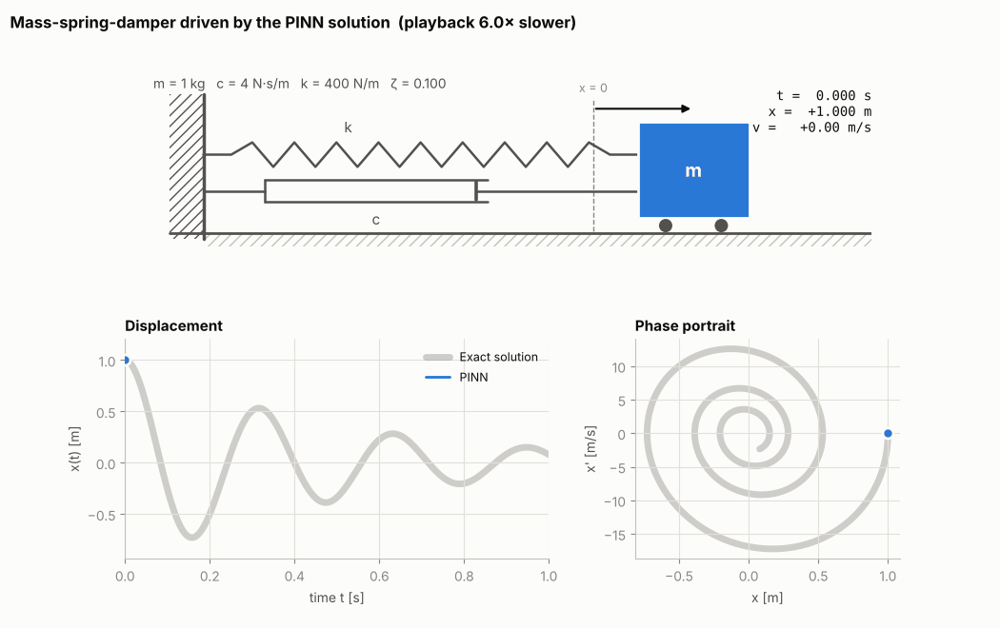
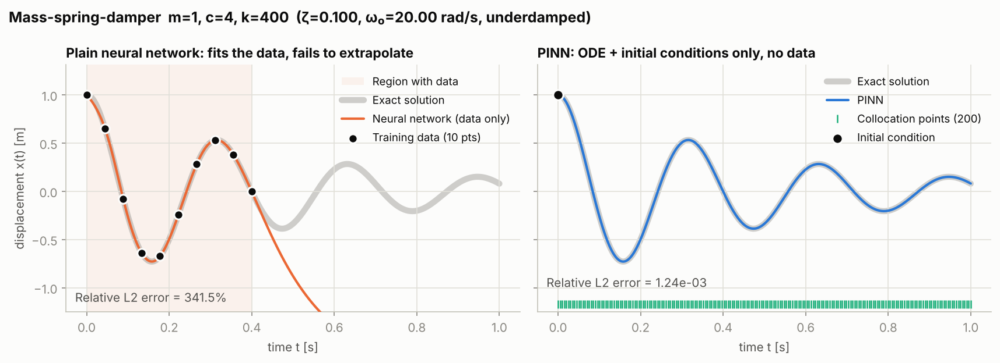
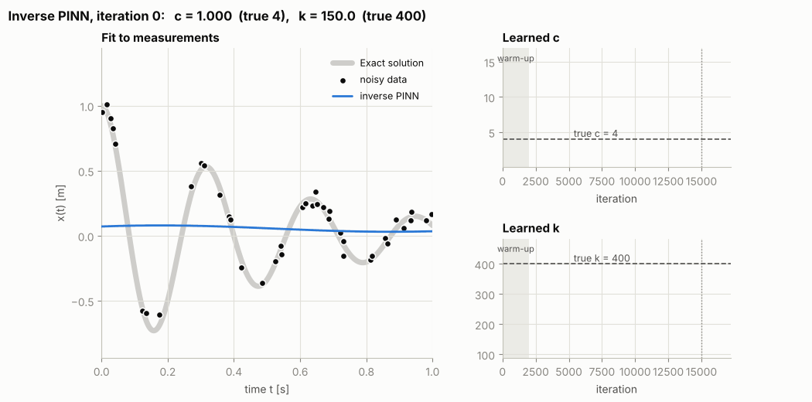
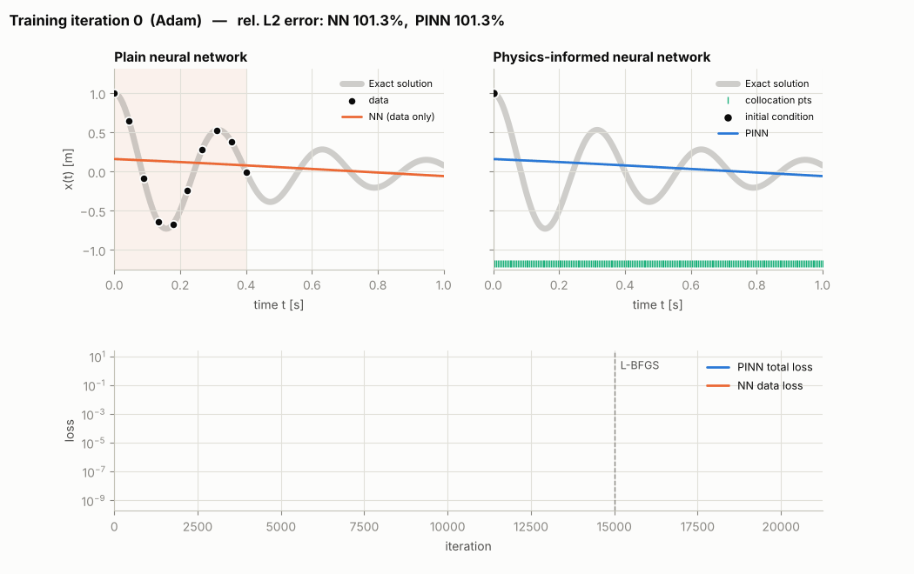
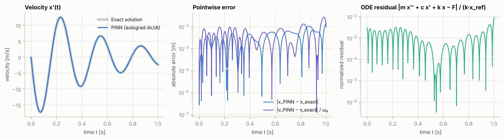
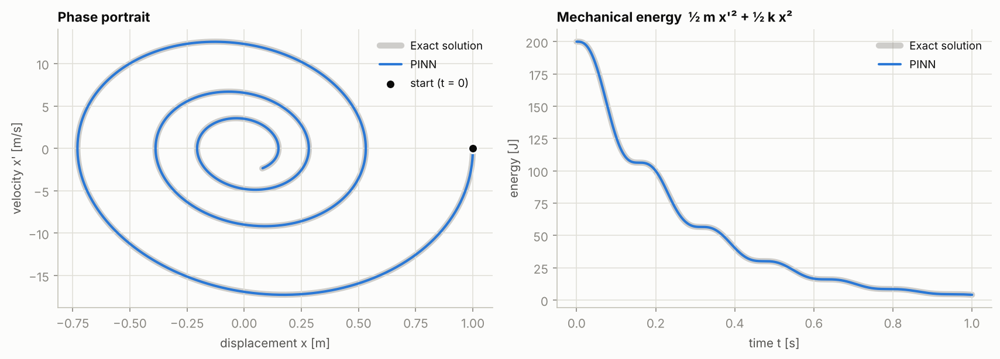
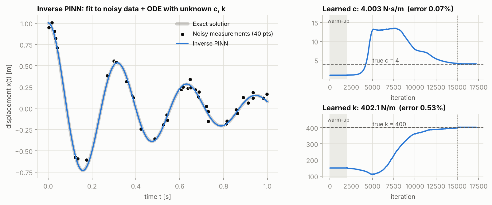

# Physics-informed neural networks for a mass-spring-damper

<p align="center">
  
</p>

<p align="center">
  
  
  
  
</p>

A single PyTorch script that solves the damped mass-spring equation with a physics-informed
neural network (PINN), compares it with an ordinary data-only network, and then runs the problem
backwards to recover unknown damping and stiffness from noisy measurements. It produces graphs
and animations of everything.

| Model | Trained on | Error in x(t) |
|---|---|---:|
| Data-only network | 10 exact points from the first 0.4 s | 341% |
| **Forward PINN** | the equation and initial conditions, **no data** | **0.12%** |
| Forward PINN, forced (`--F0 200 --wf 30`) | the equation and initial conditions, no data | 0.005% |
| **Inverse PINN** | 40 points with 4% noise, c and k unknown | 1.3% |

The inverse PINN recovered **c = 4.003** (true 4, 0.07% off) and **k = 402.1** (true 400,
0.53% off), starting from guesses of 1 and 150. Errors are relative L2 against the exact
solution over the full time window, using the default settings.

**Project page:** enable GitHub Pages (see [below](#publish-the-project-page)) to get a write-up
of the method with all figures at `https://<hossamabdellatif90>.github.io/pinn-mass-spring-damper/`.

---

## Quick start

```bash
git clone https://github.com/<hossamabdellatif90>/pinn-mass-spring-damper.git
cd pinn-mass-spring-damper

# CPU-only PyTorch is a much smaller download; skip this line if you already have torch
pip install torch --index-url https://download.pytorch.org/whl/cpu
pip install -r requirements.txt

python pinn_mass_spring_damper.py
```

A full run takes a few minutes on a laptop CPU. Everything is written to `pinn_outputs/`:

| File | Contents |
|---|---|
| `fig1_nn_vs_pinn.png` | data-only network vs PINN against the exact solution |
| `fig2_training_loss.png` | loss curves (physics, initial conditions, total) |
| `fig3_velocity_error_residual.png` | velocity from autograd, pointwise error, ODE residual |
| `fig4_phase_energy.png` | phase portrait and mechanical energy |
| `fig5_inverse_parameters.png` | inverse fit and convergence of c and k |
| `anim1_training.gif` | both networks during training |
| `anim2_mass_spring_damper.gif` | spring, damper and mass moved by the PINN solution |
| `anim3_inverse_pinn.gif` | the inverse PINN discovering c and k |
| `forward_pinn.pt`, `results.txt` | trained weights and a summary of the errors |

### Run it on GitHub, without installing anything

1. Open the **Actions** tab of this repository.
2. Choose **Run PINN** in the left-hand list, then **Run workflow**.
3. Change c, k, x0, v0, F0 or wf if you like (or add options such as `--hard-ic`), and press the green **Run workflow** button.
4. After about 5–10 minutes, open the finished run. The errors and learned c, k are shown on the page, and **pinn-outputs** under *Artifacts* is a zip of all graphs and animations.

## The problem

A block of mass *m* on a frictionless floor, attached to a wall by a spring (stiffness *k*) and
a viscous damper (coefficient *c*):

$$
m\,\ddot{x}(t) + c\,\dot{x}(t) + k\,x(t) = F(t), \qquad x(0) = x_0,\quad \dot{x}(0) = v_0
$$

The defaults are m = 1 kg, c = 4 N·s/m, k = 400 N/m, x₀ = 1 m, v₀ = 0 over one second: natural
frequency ω₀ = 20 rad/s, damping ratio ζ = 0.1, about three decaying cycles. Every model is
checked against the closed-form solution (underdamped, critically damped or overdamped), or
against a high-accuracy Runge–Kutta solve when a force F(t) = F₀ cos(ω_f t) is applied.

## How it works

The network maps time *t* to displacement x̂(t) (3 hidden layers × 32 tanh units). Automatic
differentiation gives the first and second derivatives exactly, so the equation can be checked
anywhere in the interval. The residual is made dimensionless,

$$
r(t) = \frac{m\,\ddot{\hat{x}} + c\,\dot{\hat{x}} + k\,\hat{x} - F}{k\,x_{\mathrm{ref}}},
$$

and the forward PINN minimises it at 200 collocation times plus the initial-condition error:

$$
\mathcal{L} = \frac{1}{N}\sum_{i=1}^{N} r(t_i)^2
+ \lambda_{\mathrm{ic}}\left[\left(\frac{\hat{x}(0)-x_0}{x_{\mathrm{ref}}}\right)^2
+ \left(\frac{\dot{\hat{x}}(0)-v_0}{\omega_0 x_{\mathrm{ref}}}\right)^2\right],
\qquad \lambda_{\mathrm{ic}} = 10
$$

<p align="center"></p>

**Inverse problem.** A second PINN is fitted to 40 noisy measurements while c and k are trained
alongside the network weights (as logarithms, so they stay positive):

$$
\mathcal{L} = \frac{1}{M}\sum_{j=1}^{M}\left(\frac{\hat{x}(t_j)-\tilde{x}_j}{x_{\mathrm{ref}}}\right)^2
+ \lambda_{\mathrm{phys}}\,\frac{1}{N}\sum_{i=1}^{N} r(t_i;\,c,k)^2,
\qquad \lambda_{\mathrm{phys}} = 100
$$

The mass is taken as known: in free vibration, scaling m, c and k by the same factor gives the
same motion, so only c/m and k/m are identifiable from displacement data.

<p align="center"></p>

### What made training reliable

- **Dimensionless losses.** Dividing by k·x_ref turns the residual into
  ẍ/ω₀² + 2ζẋ/ω₀ + x, so physics and initial-condition terms are the same size for any units.
- **Adam, then L-BFGS.** 15,000 Adam steps starting at lr = 3×10⁻³ (decaying tenfold), then up
  to 5,000 L-BFGS iterations. With lr = 10⁻³ and a short L-BFGS stage the PINN stalled at about
  15% error.
- **Data-only warm-up for the inverse problem.** For the first 2,000 steps only the data term is
  trained and c, k are frozen. Without it, the parameters chased a still-random network and
  settled on a wrong, heavily damped solution.
- **Optional hard initial conditions** (`--hard-ic`): x̂(t) = x₀ + v₀t + (t/T)² N(t) satisfies
  both initial conditions exactly.

<p align="center"></p>

## More results

<p align="center"></p>
<p align="center"></p>
<p align="center"></p>

## Command-line options

Run `python pinn_mass_spring_damper.py --help` for the full list with defaults.

| Option | Default | Meaning |
|---|---|---|
| `--m`, `--c`, `--k` | 1, 4, 400 | mass, damping, stiffness |
| `--x0`, `--v0` | 1, 0 | initial displacement and velocity |
| `--F0`, `--wf` | 0, 0 | forcing F(t) = F0 cos(wf t) |
| `--T` | 1 | time window [s] |
| `--width`, `--depth` | 32, 3 | network size |
| `--epochs`, `--lbfgs` | 15000, 5000 | Adam steps and L-BFGS iterations (forward PINN) |
| `--lr` | 3e-3 | initial Adam learning rate |
| `--n-col` | 200 | collocation points |
| `--w-ic` | 10 | initial-condition loss weight |
| `--hard-ic` | off | enforce the initial conditions exactly |
| `--n-data`, `--data-frac` | 10, 0.4 | baseline data points and the share of the window they cover |
| `--n-obs`, `--noise` | 40, 0.04 | inverse problem: measurements and noise level |
| `--c-init`, `--k-init` | 1, 150 | inverse problem: starting guesses |
| `--inv-warmup` | 2000 | data-only steps before physics is switched on |
| `--w-phys-inv` | 100 | inverse physics loss weight |
| `--skip-inverse` | off | skip the inverse problem |
| `--no-anim` | off | graphs only |
| `--video` | gif | `gif`, `mp4` or `both` (mp4 needs ffmpeg) |
| `--outdir` | pinn_outputs | output folder |

Examples:

```bash
python pinn_mass_spring_damper.py --c 1 --k 100          # lightly damped, slower oscillator
python pinn_mass_spring_damper.py --c 50                 # overdamped
python pinn_mass_spring_damper.py --F0 200 --wf 30       # forced vibration
python pinn_mass_spring_damper.py --x0 0 --v0 5          # start at rest position with a push
python pinn_mass_spring_damper.py --noise 0.1 --n-obs 20 # harder inverse problem
```

## Repository layout

```
pinn-mass-spring-damper/
├── pinn_mass_spring_damper.py     # everything: physics, models, training, plots, animations
├── requirements.txt
├── docs/                          # GitHub Pages site
│   ├── index.html
│   ├── site.css
│   ├── assets/                    # figures, GIFs, MP4s used by the README and the site
│   └── vendor/                    # self-hosted fonts and KaTeX (no external requests)
├── .github/workflows/
│   ├── run-pinn.yml               # "Run workflow" button: full run on GitHub, results as a download
│   └── smoke-test.yml             # quick check on every push
├── LICENSE
└── README.md
```

## Publish the project page

The site in `docs/` is plain HTML with no build step.

1. Push the repository to GitHub.
2. Open **Settings → Pages**.
3. Under **Build and deployment**, choose **Deploy from a branch**, branch **main**, folder **/docs**, and save.

After a minute the page is live at `https://<hossamabdellatif90e>.github.io/pinn-mass-spring-damper/`.
Its GitHub links fill in automatically from that address.

## References

- M. Raissi, P. Perdikaris and G. E. Karniadakis, "Physics-informed neural networks: A deep
  learning framework for solving forward and inverse problems involving nonlinear partial
  differential equations," *Journal of Computational Physics* 378 (2019) 686–707.
  [doi:10.1016/j.jcp.2018.10.045](https://doi.org/10.1016/j.jcp.2018.10.045)
- I. E. Lagaris, A. Likas and D. I. Fotiadis, "Artificial neural networks for solving ordinary
  and partial differential equations," *IEEE Transactions on Neural Networks* 9(5) (1998)
  987–1000.
- B. Moseley, ["So, what is a physics-informed neural network?"](https://benmoseley.blog/my-research/so-what-is-a-physics-informed-neural-network/)
  and its [companion code](https://github.com/benmoseley/harmonic-oscillator-pinn).

## License

Code: [MIT](LICENSE). The fonts in `docs/vendor/fonts` are under the SIL Open Font License and
KaTeX under the MIT License; their license files are included alongside them.
